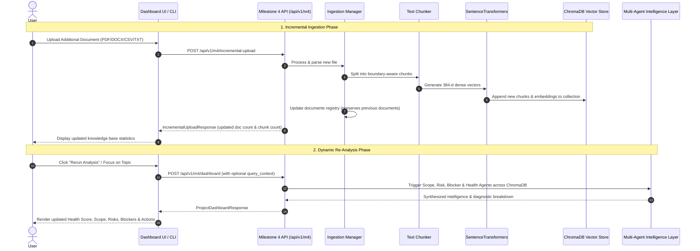

# AI Project Intelligence & Risk Advisor — System Architecture (Milestones 1–4)

This document specifies the end-to-end architecture, multi-agent network, RAG subsystem, incremental vector indexing, and dashboard orchestration for the **AI Project Intelligence & Risk Advisor** platform.

---

## 1. High-Level System Architecture

The AI Project Intelligence & Risk Advisor is an agentic, RAG-powered project analytics platform designed to continuously analyze software project artifacts (PRDs, sprint sheets, standup notes, Jira/Linear exports, architecture decision records) and generate risk forecasts, blocker resolutions, health scores, and executive intelligence.

```mermaid
graph TD
    subgraph Client Layer
        WebPortal["FastAPI Web Portal (HTML/CSS/JS)"]
        ReactUI["React + Vite Dashboard (localhost:3000)"]
        CLI["Command Line Interface (run.py)"]
        REST["REST API Clients / Swagger UI"]
    end

    subgraph API Gateway & Ingestion Layer
        FastAPI["FastAPI App Gateway (/api/v1)"]
        IngestionMgr["Ingestion Manager (src/ingestion)"]
        Parsers["Parsers (PDF, DOCX, CSV, TXT)"]
        Normalizer["Content Normalizer (Unicode NFKC)"]
        Registry["Document & Metadata Registry (JSON)"]
    end

    subgraph RAG & Vector Storage Subsystem
        Chunker["Boundary-Aware Text Splitter (500 char / 100 ovlp)"]
        Embedder["SentenceTransformers (all-MiniLM-L6-v2, 384-dim)"]
        ChromaDB[("ChromaDB Persistent Vector Store")]
        Retriever["Semantic Vector Retriever (Cosine Similarity)"]
    end

    subgraph Specialized Multi-Agent Intelligence Layer
        ScopeAgent["Scope & Deliverables Agent (M2)"]
        RiskAgent["Risk Detection & Delivery Forecast Agent (M2)"]
        BlockerAgent["Blocker & Action Item Agent (M2)"]
        Orchestrator["Multi-Agent Orchestrator (M2)"]
    end

    subgraph Health Scoring, Documentation & Conversational Layer
        HealthScorer["Project Health Scoring Module (M3)"]
        DocGenAgent["Documentation Generation Agent (M3)"]
        ChatAssistant["Conversational Project Intelligence Assistant (M3)"]
    end

    subgraph Milestone 4: Executive Insights & Risk Dashboard Layer
        M4Router["Milestone 4 Dashboard API (/api/v1/m4/dashboard)"]
        IncrementalIngest["Incremental Upload Handler (/api/v1/m4/incremental-upload)"]
        ExecutiveDashboard["Executive Project Insights & Risk Summary Dashboard"]
    end

    %% Client Interactions
    WebPortal --> FastAPI
    ReactUI --> FastAPI
    CLI --> FastAPI
    CLI --> IngestionMgr
    REST --> FastAPI

    %% Ingestion Flow
    FastAPI --> IngestionMgr
    IngestionMgr --> Parsers
    Parsers --> Normalizer
    Normalizer --> Registry
    Normalizer --> Chunker
    Chunker --> Embedder
    Embedder --> ChromaDB

    %% RAG Retrieval Flow
    FastAPI --> Retriever
    Retriever --> Embedder
    Retriever --> ChromaDB

    %% Agent Dispatch Flow
    Retriever -. Context Feed .-> ScopeAgent
    Retriever -. Context Feed .-> RiskAgent
    Retriever -. Context Feed .-> BlockerAgent
    Retriever -. Context Feed .-> HealthScorer
    Retriever -. Context Feed .-> DocGenAgent
    Retriever -. Context Feed .-> ChatAssistant

    ScopeAgent & RiskAgent & BlockerAgent --> Orchestrator
    ScopeAgent & RiskAgent & BlockerAgent --> HealthScorer
    ScopeAgent & RiskAgent & BlockerAgent --> DocGenAgent

    %% Milestone 4 Synthesis
    HealthScorer & ScopeAgent & RiskAgent & BlockerAgent --> M4Router
    M4Router --> ExecutiveDashboard
    IncrementalIngest --> IngestionMgr
```

---

## 2. Subsystem Architecture Breakdown

### 2.1 Multi-Format Document Ingestion Subsystem (`src/ingestion/`)
- **PDF Parser (`PDFParser`)**: Page-by-page text extraction, page number attribution, and document metadata extraction via `pypdf`.
- **DOCX Parser (`DOCXParser`)**: Structured heading, paragraph, and table extraction with column deduplication via `python-docx`.
- **CSV Parser (`CSVParser`)**: Converts tabular sprint/task datasets into structured semantic rows and dataset schemas via `pandas`.
- **TXT Parser (`TXTParser`)**: Robust multi-encoding reader (UTF-8, UTF-16, Latin-1, CP1252) for plain text and markdown documents.
- **Content Normalizer (`ContentNormalizer`)**: Cleans control characters, handles zero-width spaces, rejoins hyphenated wraps, and normalizes consecutive whitespaces while preserving structural breaks.
- **Ingestion Manager (`IngestionManager`)**: Validates files, computes SHA-256 hashes, coordinates parsers, manages batch uploads, and persists metadata in `data/documents_registry.json`.

### 2.2 RAG Pipeline Subsystem (`src/rag/`)
- **Text Chunker (`TextChunker`)**: Recursive boundary-aware text splitter respecting paragraph (`\n\n`), sentence (`. `), and clause boundaries with sliding-window overlap. Preserves rich provenance metadata (`document_id`, `filename`, `file_type`, `chunk_index`, `page_number`, `row_number`, `token_estimate`).
- **Embedding Service (`EmbeddingService`)**: Generates 384-dimensional dense semantic vectors using `sentence-transformers/all-MiniLM-L6-v2` with L2 unit normalization.
- **Vector Store (`ChromaVectorStore`)**: Local persistent vector index in ChromaDB utilizing cosine similarity space. Supports incremental appends without data loss.
- **Semantic Retriever (`SemanticRetriever`)**: Natural language query retrieval with cosine similarity scoring, top-k limiting, score thresholding, and metadata filtering (`document_id`, `file_type`).

### 2.3 Specialized Multi-Agent Intelligence Layer (`src/agents/`)
- **Scope & Deliverables Agent (`ScopeExtractionAgent`)**: Extracts project goals, scope boundaries (in-scope/out-of-scope/constraints), deliverables, milestones, deadlines, and responsibility assignments.
- **Risk Detection & Delivery Forecasting Agent (`RiskForecastAgent`)**: Identifies technical, schedule, dependency, operational, and staffing risks with severity ratings (`Critical`, `High`, `Medium`, `Low`), rationale, and mitigations. Computes delivery forecast and slippage probability percentage.
- **Blocker & Action Item Agent (`BlockerActionAgent`)**: Extracts active blockers, pending decisions, unresolved issues, and action items with assignees and due dates.
- **Multi-Agent Orchestrator (`Milestone2MultiAgentPipeline`)**: Coordinates all three agents and synthesizes unified project reports.

### 2.4 Health Scoring, Documentation & Conversational Assistant (`src/agents/`)
- **Project Health Scorer (`ProjectHealthScorer`)**: Multi-dimensional diagnostic scorecard (Overall Health Score 0–100, Scope Clarity Score 0–100, Timeline Risk Score 0–100, Blocker Severity Score 0–100) and actionable strategic recommendations.
- **Documentation Generation Agent (`DocumentationGenerationAgent`)**: Synthesizes Agile User Stories, Enterprise Risk Registers, and Action Item Checklists with Markdown and structured JSON export.
- **Conversational Project Intelligence Assistant (`ProjectIntelligenceChatAssistant`)**: Answers conversational questions with grounded source citations, similarity scores, and follow-up prompts.

### 2.5 Milestone 4: Executive Insights & Risk Dashboard (`src/api/m4_routes.py`)
- **Dynamic Executive Synthesis**: Live API endpoint `/api/v1/m4/dashboard` synthesizing overall project health, scope summary, extracted risks, active blockers, action items, timeline risk, and key recommendations.
- **Incremental Document Ingestion**: Ingests new PDF, DOCX, CSV, TXT files, chunks, embeds, and appends to the ChromaDB index without deleting prior documents.
- **Real-Time Knowledge Base Statistics**: Live tracking of document counts, chunk counts, and storage metrics via `/api/v1/m4/stats`.

---

## 3. Incremental Document Upload & Dynamic Re-Analysis Data Flow



---

## 4. Technology Stack Summary

| Layer | Component / Technology | Specification |
| :--- | :--- | :--- |
| **Backend Framework** | FastAPI + Uvicorn | High-performance async REST API gateway |
| **Data Validation** | Pydantic v2 + Pydantic Settings | Strict schema enforcement, types, and serialization |
| **Document Parsers** | `pypdf`, `python-docx`, `pandas` | Multi-format PDF, DOCX, CSV, TXT parsing |
| **Content Normalization** | Python `unicodedata` (NFKC) | Whitespace sanitization, control char removal, structural boundaries |
| **Text Chunking** | Hierarchical Splitter | 500-char target, 100-char sliding overlap |
| **Embedding Engine** | `sentence-transformers/all-MiniLM-L6-v2` | 384-dimensional dense vectors with L2 normalization |
| **Vector Database** | ChromaDB | Persistent local cosine vector database |
| **Multi-Agent Network** | Custom Autonomous Python Agents | Scope, Risk/Forecast, Blocker, Health Scorer, Doc Gen, Chat |
| **Web Portal UI** | Vanilla HTML5 / Modern CSS / Vanilla JS | Fast, responsive glassmorphic dark-mode web portal |
| **React Frontend** | React 19 + Vite | Componentized modern executive dashboard |
| **Automated Testing** | Pytest + AnyIO + HTTPX | 50 automated tests covering all 4 milestones |
